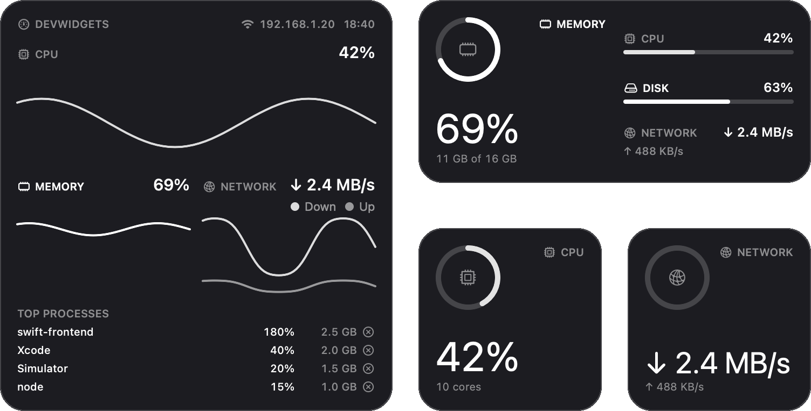
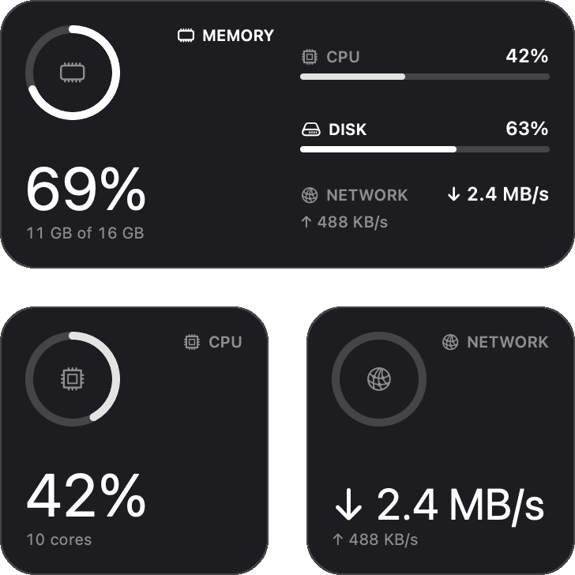
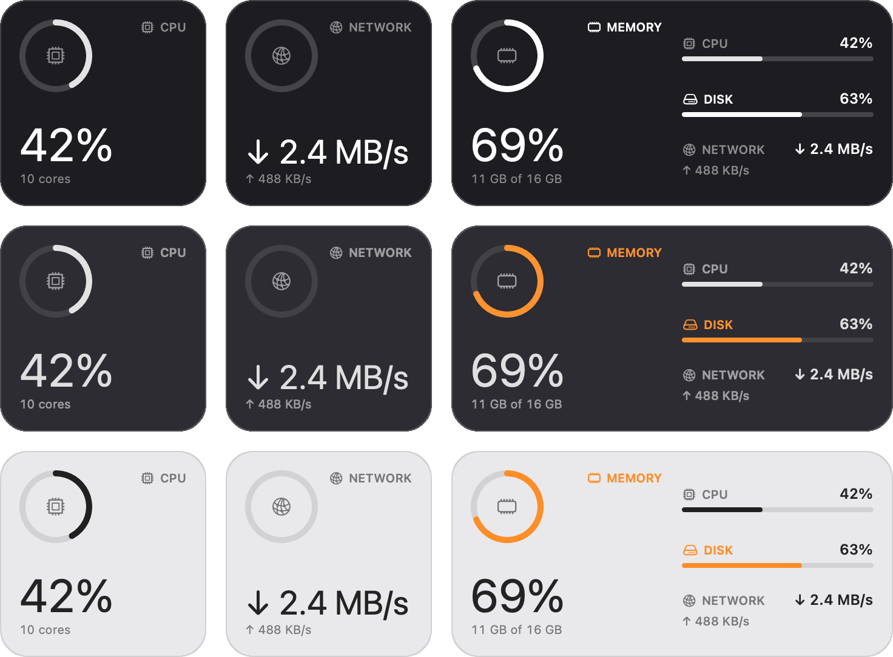
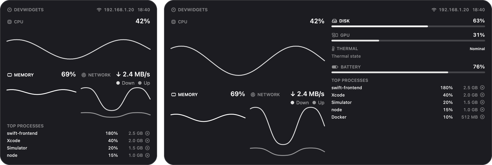
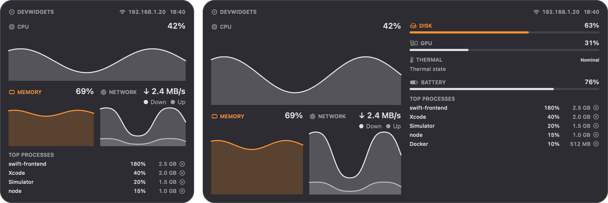
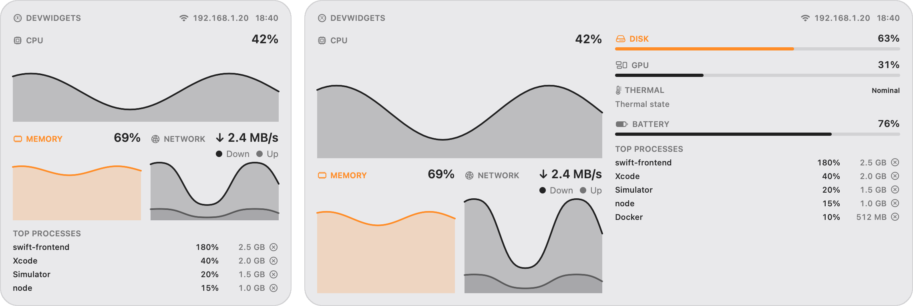
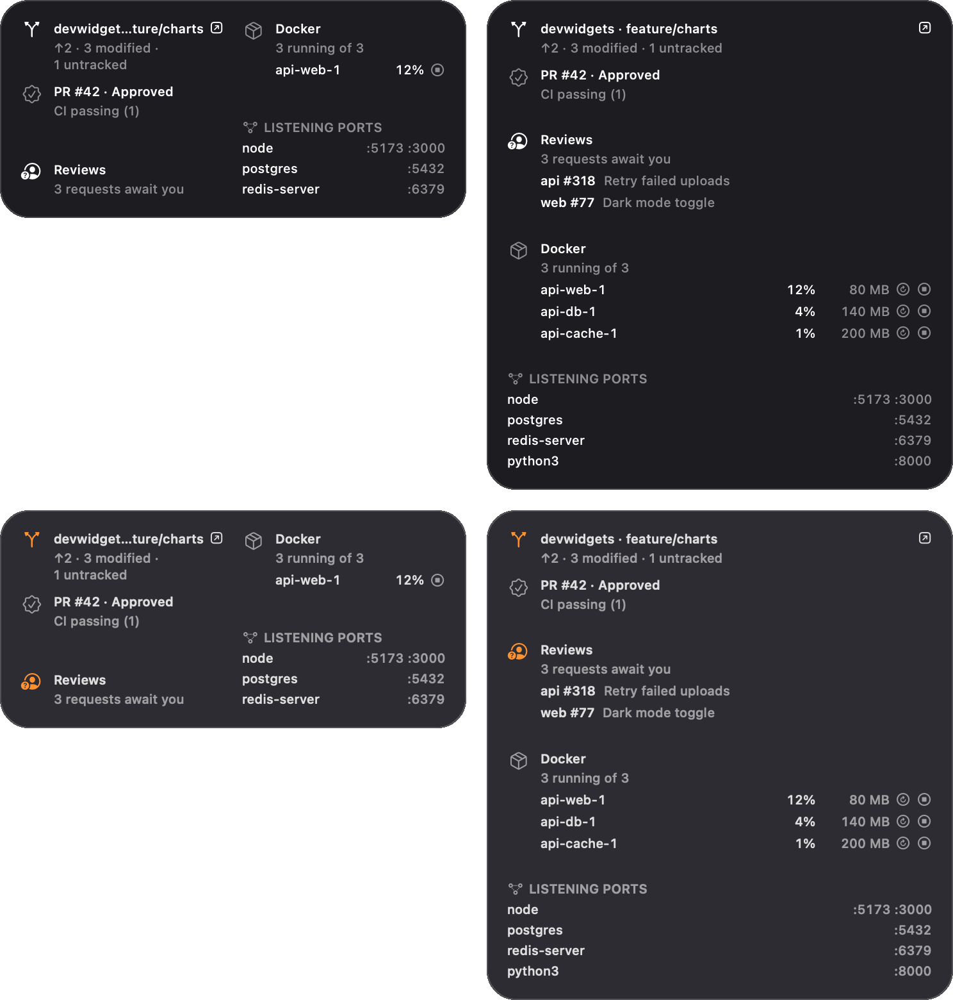
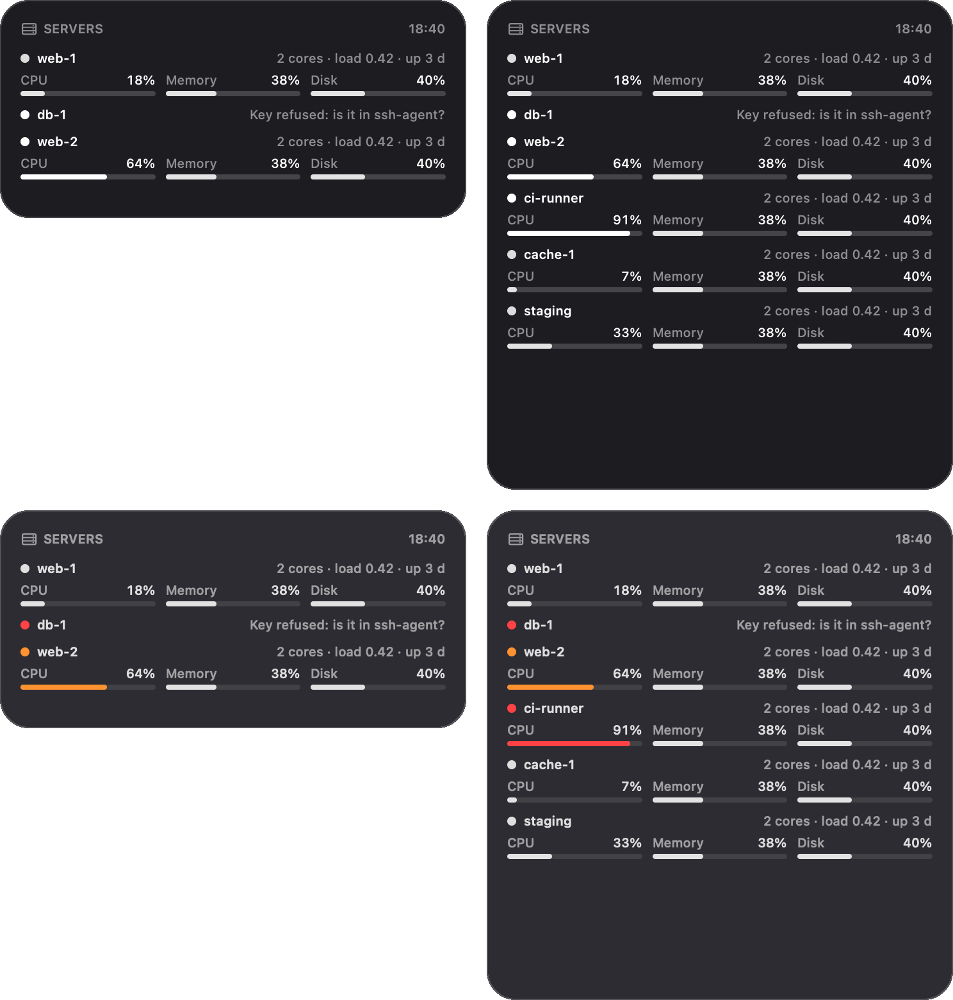
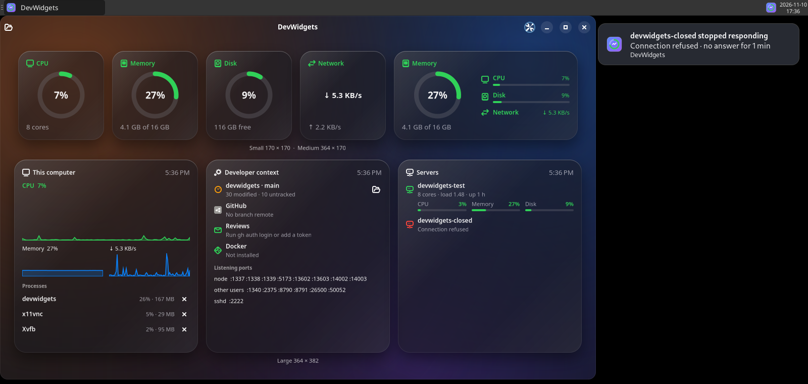
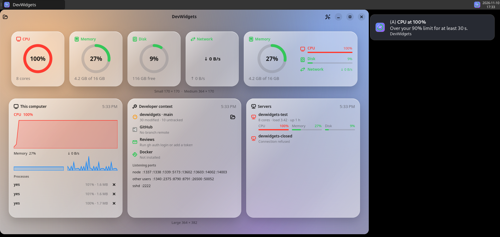

<div align="center">



# devwidgets

### System and project monitoring widgets for developers.

**Native macOS 26 widgets (SwiftUI + WidgetKit, Liquid Glass) and a GTK 4 app for Linux, on one tested Swift core.**

devwidgets puts **what your machine and your project are doing** on the desktop: CPU, memory, disk, network, GPU, temperature and battery, next to your Git branch, CI, pull requests, Docker containers, listening ports and SSH servers.

[Quick Start](#quick-start) | [Gallery](#gallery) | [Features](#what-you-can-do) | [How It Works](#how-it-works) | [Testing](#testing)

[](https://github.com/suarezsp/dev-widgets/actions/workflows/ci.yml)
[](#requirements)
[](https://swift.org)
[](https://developer.apple.com/widgets/)
[](#linux)
[](#testing)
[](LICENSE)

**MIT** | macOS 26+ and Linux | widgets, menu bar app, alerts, interactive actions

</div>

---

> **devwidgets** is a set of desktop widgets and a menu bar app for people who write software. One portable Swift core samples the machine, reads the developer context of a project (Git, GitHub, Docker, ports) and polls remote Linux servers over your own `ssh`. On macOS it feeds WidgetKit widgets that use the system's own Liquid Glass; on Linux it feeds a GTK 4 dashboard with the same sizes.

> The widgets answer the two questions you ask most while you work: *is my machine OK?* and *is my project OK?*, without opening Activity Monitor, a terminal and three browser tabs.

---

## What is devwidgets?

- **macOS widgets** (WidgetKit): a configurable metric widget (small, medium), a dashboard (large, extra large) with history charts, a developer-context widget (medium, large) and a servers widget (medium, large). They use the system widget background, so in the clear and tinted presentations of macOS 26 they get the same Liquid Glass as Apple's widgets.
- **Menu bar app** (SwiftUI): samples every second, shows a live two-column panel, sends threshold and failed-CI notifications, polls SSH servers and performs the widgets' actions.
- **Interactive widgets** (App Intents): stop or restart a container, quit a process (tap twice to confirm), open the project in your editor.
- **Linux app** (GTK 4 + libadwaita through Swift's C interop): the same cards at the macOS widget sizes, a tray icon (StatusNotifierItem) whose right-click menu shows or hides the dashboard, opens Preferences or quits, desktop notifications, and `.deb` and `.rpm` packages for `x86_64` and `arm64`.
- **Portable core** (`DevWidgetsCore`): no UI and no Apple-only APIs, so everything that can be tested is tested on Linux and on macOS.

---

## Preview

Every macOS image below is the **real SwiftUI view** of the widget, drawn with `ImageRenderer` at the macOS widget sizes, with the sample data the widget gallery shows. Only the widgets are shown, on a neutral platter: on the desktop, macOS draws its own Liquid Glass behind them. The Linux images are real screenshots of the installed `.deb`.

<div align="center">



</div>

---

## Gallery

### Small and medium: clear glass, dark and light

<div align="center">

</div>

### Dashboard: large and extra large

<div align="center">

<br/><sub>Clear glass, the presentation macOS 26 uses on a glass desktop</sub><br/><br/>

<br/><sub>Dark, full color: orange only because memory pressure is elevated</sub><br/><br/>

<br/><sub>Light, full color</sub>
</div>

### Developer context and servers: medium and large

<div align="center">

<br/><sub>Git, pull request and CI, review queue, Docker with stop and restart buttons, listening ports</sub><br/><br/>

<br/><sub>Six sample servers; <code>db-1</code> shows why it failed</sub>
</div>

### Linux (GTK 4 + libadwaita)

<div align="center">

<br/><br/>

<br/><sub>Real screenshots on a virtual XFCE desktop</sub>
</div>

---

## What You Can Do

| Widget | Sizes | Shows | Actions |
|--------|-------|-------|---------|
| **Metric** | small, medium | One metric you pick (CPU, memory, disk, network, GPU, temperature, battery) as a ring and a large value; medium adds three companion rows | — |
| **Dashboard** | large, extra large | CPU, memory and network history (Swift Charts), busiest processes; extra large adds disk, GPU, temperature and battery | quit a process |
| **Developer context** | medium, large | Git branch, ahead/behind and changes; pull request, review state and CI; your review queue; Docker containers with CPU and memory; listening ports by program | stop / restart a container, open the project |
| **Servers** | medium, large | Linux servers over `ssh`: CPU, memory and disk bars, load, uptime, and a clear reason when one fails (e.g. key refused) | — |

| Feature | How |
|---------|-----|
| **System metrics** | Mach host statistics, `sysctl` (64-bit network counters), IOKit (disk I/O, GPU), power sources, thermal state and `libproc` on macOS; `/proc` and `/sys` on Linux |
| **Docker** | `docker stats` / `docker ps` through a timed command runner |
| **Listening ports** | `lsof` (macOS) and `/proc/net` (Linux), grouped by owning program |
| **Git** | `git status --porcelain=v2 --branch` of the chosen project folder |
| **GitHub CI and pull requests** | REST API (token in the Keychain) or the `gh` CLI, with an ETag cache; failed runs open on click. github.com or a GitHub Enterprise Server host (Settings › GitHub on macOS, `GH_HOST` on Linux) |
| **SSH servers** | your system `ssh` with your keys and `~/.ssh/config` (including `Include`); no passwords stored |
| **Alerts** | thresholds per metric with debounce, failed CI, server down; macOS notifications or Linux desktop notifications |
| **Menu bar** | live panel every second: metrics, processes, context, servers and any problem (for example, widgets that cannot be updated) |
| **Languages** | English and Spanish, from one String Catalog: macOS follows the system language, Linux reads `LANGUAGE`, `LC_ALL`, `LC_MESSAGES` and `LANG` |

---

## Problem It Solves

- **The state of your machine is one app away, every time.** A build that pegs the CPU, a container eating memory or a full disk shows up on the desktop before it slows you down.
- **The state of your project is spread over tools.** Branch, CI, pull request reviews, containers and ports are in a terminal, a browser and Docker Desktop. The context widget puts them in one place, and its buttons act on them.
- **Remote servers need a terminal to check.** The servers widget polls them with the `ssh` you already use, and says what to fix when one fails.
- **Widgets that look foreign.** devwidgets uses the system's widget background and rendering modes instead of a fake glass, so it sits next to Apple's widgets without standing out.

---

## How It Works

```
Package.swift                SwiftPM: core, macOS reader, Linux app, probe, tests
Sources/
  DevWidgetsCore/            portable core: metrics, history, snapshot store,
                             Docker/ports/Git, GitHub, alerts, actions, SSH servers,
                             Linux /proc and /sys reader
  DevWidgetsDarwin/          macOS reader: Mach, sysctl, IOKit, power, libproc
  DevWidgetsLinuxShell/      Linux app logic without GTK (settings, alerts, tray)
  CGtk/  devwidgets-linux/   GTK 4 + libadwaita app (built where the headers exist)
  devwidgets-probe/          CLI that prints snapshots and context as JSON
macOS/
  project.yml                XcodeGen spec: app + widget extension, team, App Group
  App/                       menu bar app: sampling, panel, notifications, Settings
  Widgets/                   WidgetKit extension and App Intents
  Shared/                    code in both targets: App Group, presentation, rows
  Render/                    ImageRenderer program for the widget images
Tests/                       Swift Testing suites and recorded fixtures
packaging/                   .deb and .rpm metadata, AppStream, man page, Flatpak (experimental)
tools/                       lint, style checker, .deb and .rpm builders, render and compose scripts
docs/                        README banner and gallery images
```

```
DarwinSampleReader / LinuxSampleReader        cumulative counters
        │ RawSample
        ▼
MetricsMonitor ─► MetricsRecorder             rates, 300-sample history
        │ MetricSnapshot
        ├─► menu bar panel                    every second
        └─► SnapshotStore in the App Group ─► WidgetKit timelines
            every 60 s + WidgetCenter reload
```

- **App Group, team-prefixed.** The app and the extension share snapshots through a team-prefixed App Group, `$(TeamIdentifierPrefix)` plus the `APP_GROUP_IDENTIFIER` set in `macOS/project.yml`. On macOS this form needs no registration, provisioning profile or user prompt; both targets read it from the Info.plist key `DevWidgetsAppGroup`, so the code names no team. If saving fails, the menu bar panel says so.
- **WidgetKit refresh limits.** WidgetKit budgets reloads, so a widget cannot refresh every second. The menu bar app is the live view; the widgets show the latest snapshot, published at most once a minute.
- **Native Liquid Glass.** Widgets use `containerBackground(.fill.tertiary, for: .widget)` and no background of their own. In the clear and tinted presentations macOS removes it and draws its glass; views read `widgetRenderingMode` and keep color for warnings only.
- **Not sandboxed app, sandboxed widgets.** The menu bar app lists and quits processes, which the App Sandbox forbids; the widget extension stays sandboxed and only reads the shared files and sends action requests.
- **Abstractions only where they pay.** `RawSampleReader`, `CommandRunner` and `GitHubTransport` each have more than one real implementation besides test doubles.

---

## Quick Start

### Requirements

- **macOS app and widgets:** macOS 26+, Xcode 26+, [XcodeGen](https://github.com/yonaskolb/XcodeGen) (`brew install xcodegen`), an Apple developer team to sign with.
- **Core and Linux app:** Swift 6.2+; for the GTK app, `libgtk-4-dev` and `libadwaita-1-dev`.

### macOS

```sh
git clone https://github.com/suarezsp/dev-widgets.git
cd dev-widgets/macOS
# set DEVELOPMENT_TEAM in project.yml to your team ID
xcodegen generate
open DevWidgets.xcodeproj          # run the DevWidgetsApp scheme
```

Or from the command line:

```sh
xcodebuild -project DevWidgets.xcodeproj -scheme DevWidgetsApp \
  -allowProvisioningUpdates DEVELOPMENT_TEAM=<your team ID> build
```

Open the app once (it lives in the menu bar and, from then on, starts at login; Settings › General turns that off), then add the widgets from the widget gallery.

### Linux

```sh
swift build && swift test           # core, on Linux or macOS
swift run devwidgets-probe 5        # real snapshot of this machine as JSON
swift run devwidgets-linux          # the GTK app
tools/package_deb.sh                # dist/devwidgets_<version>_<arch>.deb
tools/package_rpm.sh                # dist/devwidgets-<version>-1.<arch>.rpm
```

---

## Distribution

macOS, outside the App Store, as a signed and notarized DMG:

1. Sign with a **Developer ID Application** certificate (Xcode › Product › Archive › Distribute App › Direct Distribution).
2. Notarize: Xcode does it in the same step, or `xcrun notarytool submit DevWidgets.dmg --keychain-profile <profile> --wait`, then `xcrun stapler staple DevWidgets.dmg`.
3. Ship a DMG with `DevWidgets.app` and a link to `/Applications` (`hdiutil create -volname DevWidgets -srcfolder <folder> -format UDZO DevWidgets.dmg`), signed and notarized too.

Developer ID certificates and notarization need the **paid Apple Developer Program**; a free account only signs for your own Mac. Users just open the DMG, drag the app to Applications, open it once and add the widgets. They never touch folders or settings.

Linux: `tools/package_deb.sh` builds the `.deb` and `tools/package_rpm.sh` the `.rpm` (it needs `rpmbuild`), each for the architecture it runs on; both stage the same files with `tools/stage_linux.sh`. The `.rpm` is built on Ubuntu and has not been installed on Fedora yet. `packaging/flatpak` holds an experimental manifest that builds and runs; its README lists what works inside the sandbox (Git, Docker and `gh` run on the host; the process list does not see it yet).

---

## Testing

```sh
swift test                          # Swift Testing suites
tools/lint.sh                       # swift-format, SwiftLint, check_style.py
tools/swift_test_clt.sh             # swift test with only the Command Line Tools
tools/check_macos_clt.sh            # typecheck app + widgets without Xcode
tools/ssh_test_server.sh            # optional local sshd for the live SSH suite
```

On Linux the tests expect the English texts: with a Spanish locale,
run them as `LC_ALL=C swift test`.

| Platform | Tests |
|----------|-------|
| Linux (Swift 6.4) | **234 tests in 52 suites** |
| macOS 27 (Apple silicon) | **236 tests in 53 suites**, including the `DarwinReaderTests` that read the real Mac |

| Suite | What it checks |
|-------|----------------|
| `DevWidgetsCoreTests` | metric math and rates, history, snapshot store, `/proc` and `/sys` parsers, Docker, `lsof`, Git and GitHub parsing against recorded fixtures, ETag cache, alerts and debounce, action inbox and two-tap confirmation, SSH config (`Include`) and remote parsing |
| `DevWidgetsPresentationTests` | the portable presentation code of `macOS/` compiled on Linux: texts, levels, preview data, and that both Xcode targets share the team-prefixed App Group |
| `DevWidgetsLinuxShellTests` | settings file, alert routing, tray texts and menu, launch options |
| `DevWidgetsDarwinTests` | macOS only: the Darwin reader against the real machine |

`Tests/Fixtures/README.md` says which fixtures are recorded from real tools and which are hand-written. A live SSH suite runs when `DEVWIDGETS_SSH_TEST_CONFIG` points at the local test server. `.github/workflows/ci.yml` builds and tests on Linux, builds the GTK app on `x86_64` and `arm64` runners and uploads its `.deb` and `.rpm` as artifacts, and builds the macOS targets on a `macos-26` runner.

---

## Code style

Enforced by `tools/lint.sh` (swift-format, SwiftLint and `tools/check_style.py`):

- `MAYUS_NAME` constants, `this_Name` variables, properties, parameters and enum cases, `thisName` functions, `PascalCase` types. Names say exactly what they hold; no abbreviations.
- Lines ≤ 70 columns, functions ≤ 25 lines, ≤ 3 parameters, cyclomatic complexity ≤ 10.
- Names imposed by Apple frameworks are allow-listed in the checker.
- SOLID and YAGNI where they help; no abstraction without a second real implementation.
- User-facing text is a SwiftUI literal or `String(localized:)`. On macOS, `tools/sync_strings.sh <DerivedData>` adds new texts to `macOS/Shared/Localizable.xcstrings` after a build; core and Linux texts are added by hand with `"extractionState" : "manual"`. A test fails while a text is missing or has no Spanish.

---

## Roadmap and known limitations

- **No signed release yet.** Developer ID signing, notarization and a DMG are documented above but not done.
- **Desktop captures.** The macOS images are renders of the real views on a neutral platter, not desktop screenshots.
- **Checked on one Mac.** GPU under load, the exact set of processes visible without privileges and thermal states under heat are not verified yet.
- **Temperature on macOS** is the thermal state the system reports (Nominal, Warm or Throttling), not degrees: macOS has no public API for sensor temperatures, and reading the SMC would be private and fragile. Linux shows degrees from `/sys/class/thermal`. This will change if Apple adds a public API.
- **Linux** was tested on a virtual XFCE desktop (Xvfb, no GPU); GNOME, KDE and Wayland, the tray menu in a real panel (its D-Bus replies were checked with `gdbus`) and NVIDIA GPUs (read through `nvidia-smi`, checked only against hand-written output) are still to check. The Flatpak builds and runs; its process list and port owners see only the sandbox.
- **GitHub and Docker** were tested against recorded or hand-written responses; a signed-in run is pending.
- **CI** has not run yet; it first runs when the repository is pushed.
- What is still missing for v1.0 is tracked in the [issues](https://github.com/suarezsp/dev-widgets/issues).

---

## Privacy

devwidgets has no server, account or analytics. It talks only to
GitHub (once you set it up) and to the SSH servers you add.
[PRIVACY.md](PRIVACY.md) lists what it reads, runs, sends and
stores, and every permission prompt.

---

## License

MIT, see [LICENSE](LICENSE).

---

<div align="center">

**devwidgets**: macOS widgets | menu bar | Linux GTK 4 | system metrics | Git, GitHub, Docker, SSH

</div>
